# Layout do cadastro de cliente (substituir o accordion)

> ## ✅ Decidido — 01/10/2026 · **A — Abas**, com Revisão e pergunta de sexo
>
> Doze alternativas ao accordion foram montadas e comparadas na própria
> tela; no primeiro corte ficaram A, D e I, e a escolha final foi **A —
> Abas**, com dois acréscimos pedidos junto com ela (seção 8): uma aba de
> **Revisão** com todos os campos e uma **pergunta de sexo** ao escolher a
> aposentadoria por deficiência. As outras onze tiveram o código removido;
> descrição e prints ficam aqui como histórico.

## 1. O problema

O cadastro (`/clientes/novo`) tem 6 seções (7 com "Períodos de deficiência")
num accordion de cartões. O incômodo: abrir e fechar cartão para achar o
campo, várias seções abertas empilhadas, e nenhuma visão rápida de onde se
está no formulário.

## 2. Como foi comparado

Durante a avaliação, uma faixa **"Layout em avaliação"** abaixo do
cabeçalho trocava o layout na hora, sem perder o que já fora digitado (o
estado mora na página), e cada opção tinha link direto (`?layout=…`). A
faixa saiu com a decisão; o cadastro agora abre sempre em abas.

## 3. As opções

### A — Abas (`TabsLayout`) — ✅ escolhida

Uma seção por vez; a barra de abas mostra todas, com um ponto de estado
(dourado = pendente, verde = pronto/salvo). Rodapé com "Próxima: …".

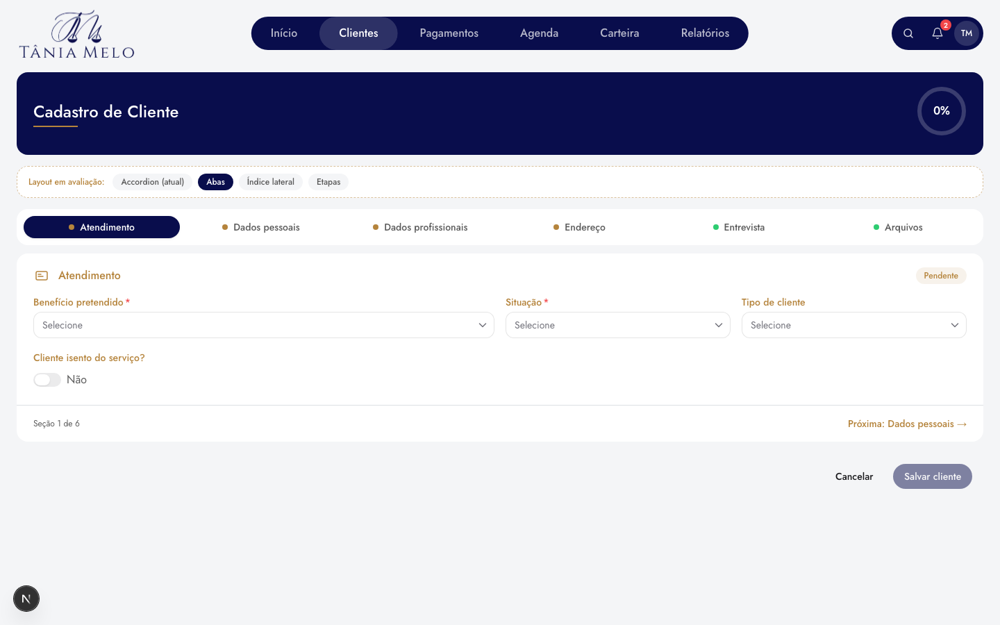

| Prós | Contras |
|---|---|
| Tela curta, sem rolagem longa | Campo com erro pode estar em outra aba (mitigado: o salvar leva até a seção com erro) |
| Navegação direta, padrão conhecido | 7 abas não cabem no celular — a barra rola horizontalmente |
| Mesmo padrão das abas de endereço | Não dá para ver duas seções juntas |

### B — Índice lateral (`IndexLayout`) — ❌ descartada

Todas as seções abertas, uma embaixo da outra, com um índice fixo à esquerda
que acompanha a rolagem e salta para qualquer seção. No celular o índice
vira uma faixa de atalhos presa no topo.

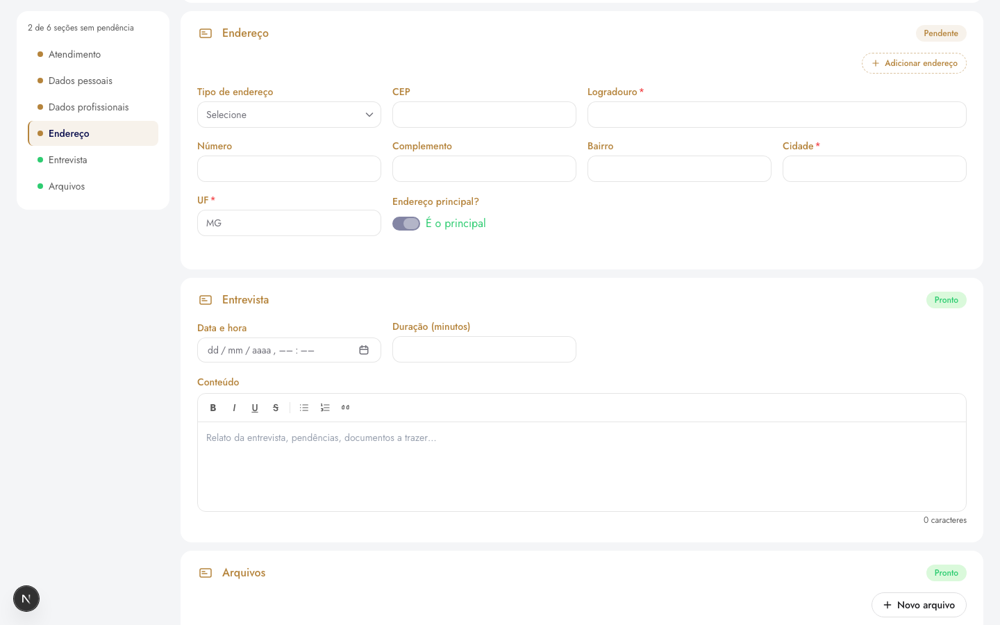

| Prós | Contras |
|---|---|
| Nada escondido: o que está na tela é o que vai ser salvo | Página longa |
| Ctrl+F do navegador acha qualquer campo | Ocupa ~220px de largura no desktop |
| Melhor para revisar o cadastro inteiro antes de salvar | Mais "pesado" visualmente com as 7 seções abertas |

### C — Etapas (`StepsLayout`) — ❌ descartada

Assistente: trilha numerada no topo, uma seção por vez, "Voltar" e
"Avançar". Qualquer etapa pode ser aberta clicando na trilha. "Salvar
cliente" continua no rodapé — dá para salvar depois das 3 obrigatórias, sem
passar pelas opcionais.

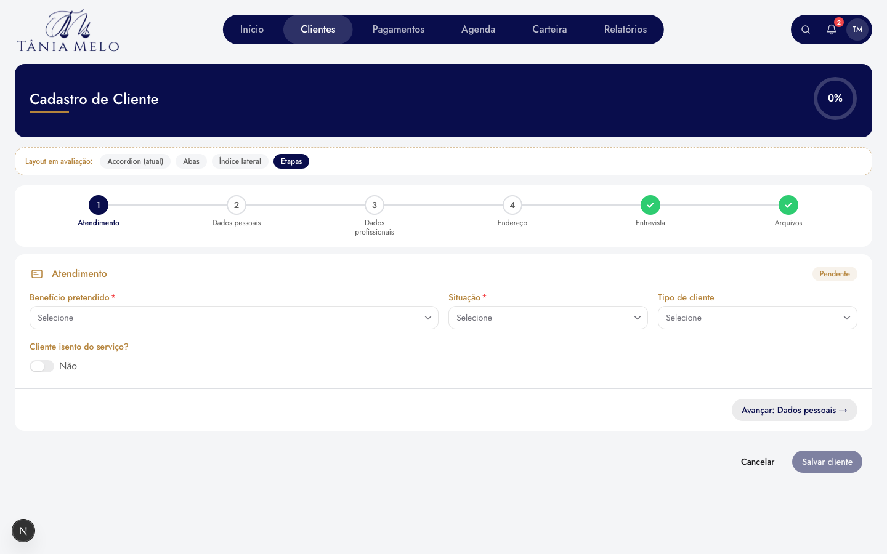

| Prós | Contras |
|---|---|
| Guia quem cadastra pela primeira vez | Sugere ordem obrigatória que não existe |
| Mostra progresso de forma clara | Etapas opcionais vazias aparecem com ✓ (seguem o selo "Pronto" — ajustar se escolhida) |
| Bom no celular ("Etapa 2 de 6") | Mais cliques para quem já sabe o que quer preencher |

### D — Menu lateral (`MenuLayout`) — ❌ finalista, não escolhida

Desenho de tela de configurações: a lista de seções fica à esquerda, sempre
à vista e com o estado de cada uma; à direita aparece **só** a seção
escolhida, com atalhos para a anterior e a próxima no rodapé. No celular a
lista vira a faixa de atalhos do índice.

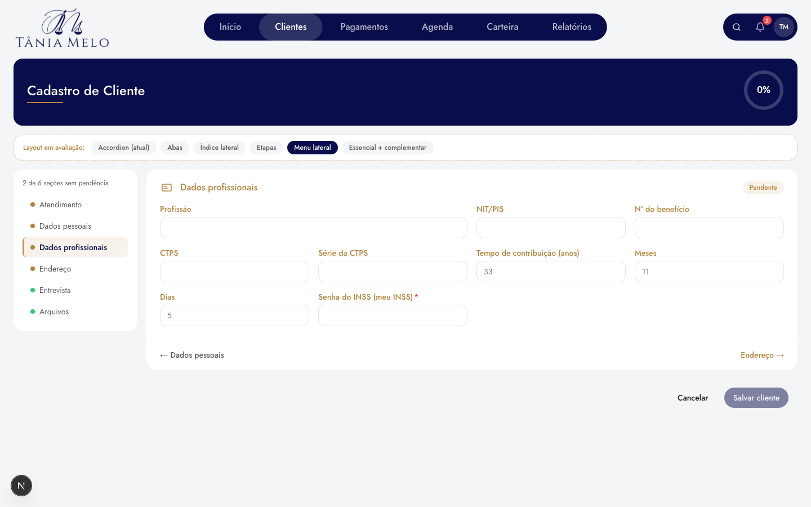

| Prós | Contras |
|---|---|
| Visão de todas as seções + foco em uma | Parecido com as abas; muda a posição da lista, não a ideia |
| Cabe nome longo e mais seções sem cortar | Ocupa ~220px de largura no desktop |
| Tela curta, como nas abas | Não dá para ver duas seções juntas |

### E — Essencial + complementar (`EssentialLayout`) — ❌ descartada

O formulário dividido do jeito que o salvamento já funciona. **Essencial**
(Atendimento, Dados pessoais, Dados profissionais — o `POST /clients`) fica
sempre aberto no topo, com "N de 3 prontas". **Complementar** (Deficiência,
Endereço, Entrevista, Arquivos) vai para abas logo abaixo.

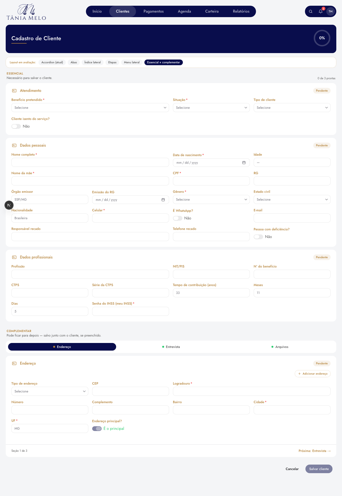

| Prós | Contras |
|---|---|
| Deixa claro o mínimo para salvar | Página longa na parte essencial |
| Cadastro rápido não precisa abrir nada | Dois padrões na mesma tela (cartões + abas) |
| Segue a regra real do backend (cliente primeiro, sub-recursos depois) | Se a regra de obrigatoriedade mudar, a divisão muda junto |

### F — Painel bento (`BentoLayout`) — ❌ descartada

Mosaico no topo: um bloco grande com a ficha (iniciais, nome, benefício e
quantas obrigatórias estão prontas) e um bloco por seção com o que já foi
preenchido, ou "Falta: CPF, Gênero…". O bloco escolhido abre o formulário
logo abaixo. Mesmo vocabulário do painel bento da Carteira.

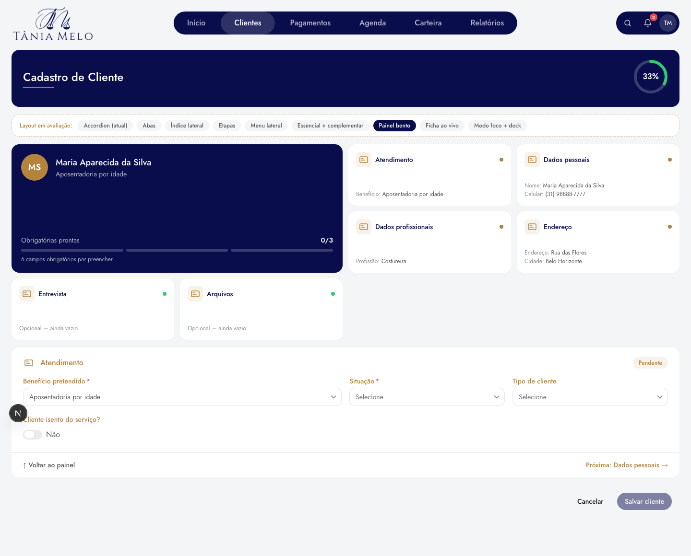

| Prós | Contras |
|---|---|
| Visão geral do cadastro de relance | O formulário fica abaixo do mosaico — mais rolagem no celular |
| Diz o que falta sem abrir a seção | Com 6 seções sobram blocos vazios na grade (com 7, fecha) |
| Conversa com o padrão já adotado na Carteira | Mais um componente visual para manter |

### G — Ficha ao vivo (`LiveSheetLayout`) — ❌ descartada

Formulário contínuo à esquerda; à direita, presa, a ficha do cliente que se
monta enquanto se digita: avatar, nome, benefício, a lista "Para salvar"
(cada item leva à seção) e o resumo de cada seção. No celular vira uma faixa
fina no topo: nome + "Faltam N".

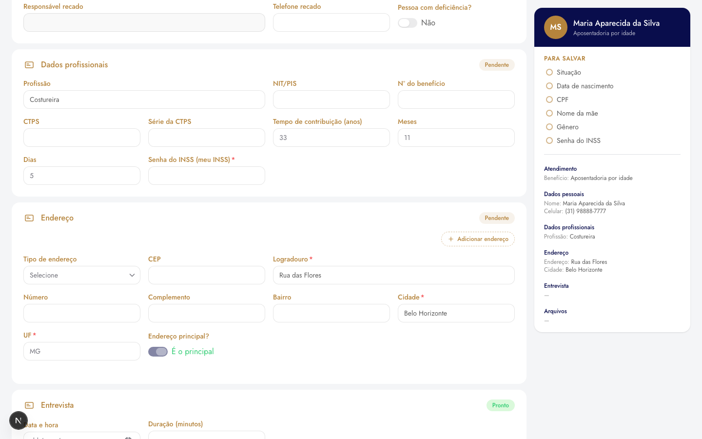

| Prós | Contras |
|---|---|
| Mostra o que já se tem do cliente sem rolar de volta | Ocupa ~320px no desktop; campos ficam mais estreitos |
| Lista do que falta é clicável | No celular a ficha some (fica só a faixa) |
| Ótimo para conferir antes de salvar | Página longa, como o índice |

### H — Modo foco + dock (`FocusDockLayout`) — ❌ descartada

Uma seção por vez numa coluna central, com contador "02 / 06", título
grande e barra segmentada de progresso. Embaixo, um dock flutuante
translúcido com todas as seções, o estado de cada uma e as setas; fora de um
campo, **← / →** do teclado trocam de seção. O dock é `sticky`: pousa no fim
do formulário e nunca cobre o "Salvar cliente". No celular ele mostra só
números.

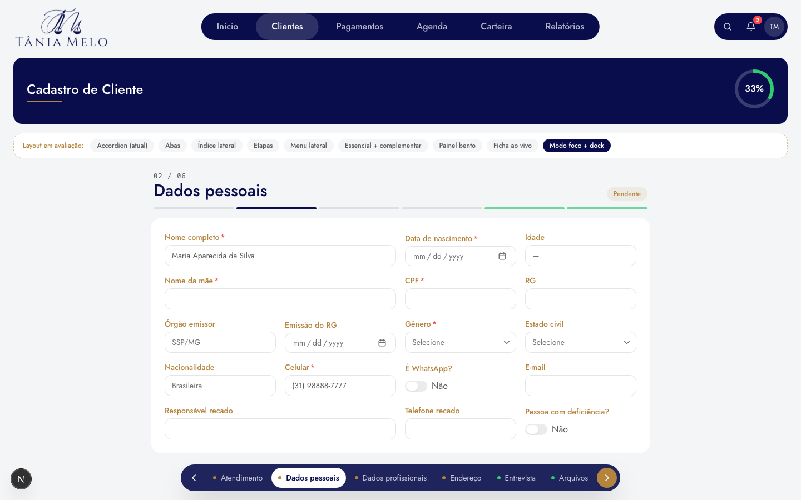

| Prós | Contras |
|---|---|
| Tela limpa, uma coisa por vez | Coluna central desperdiça largura em telas grandes |
| Navegação sempre à mão (dock + teclado) | Atalho de teclado precisa ser descoberto |
| Visual mais atual (contador, dock translúcido) | Também esconde as outras seções, como abas/etapas |

### I — Tela dividida guiada (`GuidedSplitLayout`) — ❌ finalista, não escolhida

Referência: telas de onboarding em *split screen* (Dribbble; o formulário de
cadastro da Stripe). Painel da marca à esquerda com a trilha de etapas; a
etapa atual se abre numa frase dizendo o que ela pede e por quê. À direita,
só o formulário da etapa, com "Voltar" e "Continuar". No celular o painel
vira um cabeçalho com a etapa e a explicação.

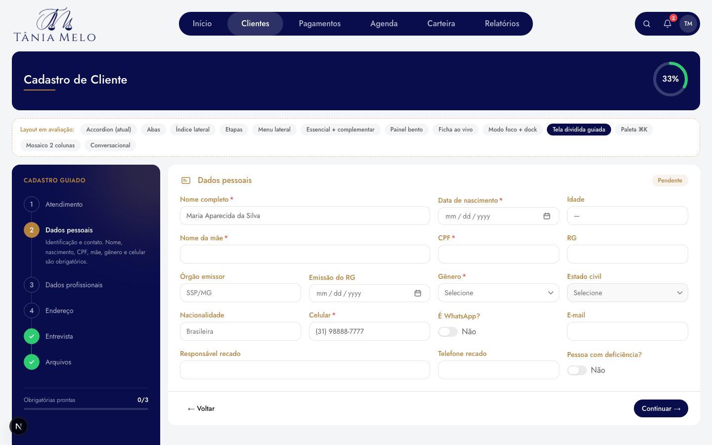

| Prós | Contras |
|---|---|
| Explica cada bloco — bom para quem está aprendendo | Painel ocupa ~300px |
| Identidade da marca forte na tela | Parecido com etapas/menu na navegação |
| Progresso das obrigatórias sempre visível | Uma seção por vez |

### J — Paleta ⌘K (`PaletteLayout`) — ❌ descartada

Referência: paletas de comando do Linear, Raycast e Vercel. Formulário
contínuo, com uma barra fina no topo ("Você está em…", quantos obrigatórios
faltam, botão "Ir para… ⌘K"). ⌘K ou Ctrl+K abre uma busca: "cpf" + Enter
rola até Dados pessoais **e põe o cursor no campo CPF**. Lista primeiro os
obrigatórios vazios, depois as seções.

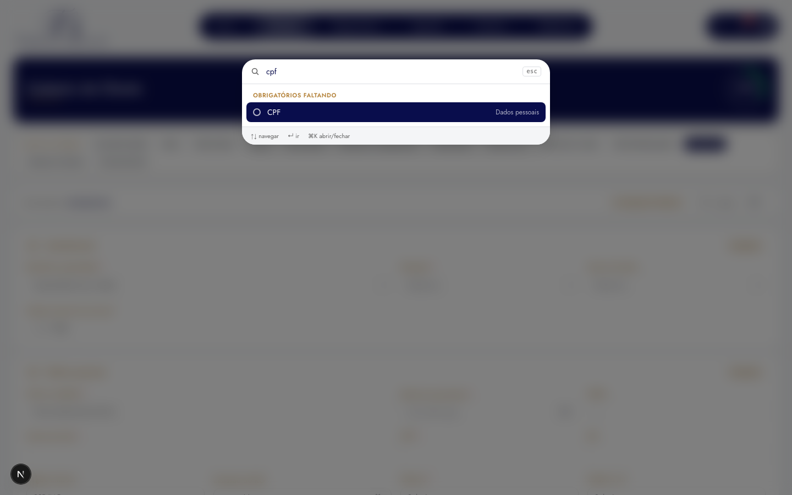

| Prós | Contras |
|---|---|
| O mais rápido para quem usa teclado todo dia | Quem não conhece o atalho talvez nem descubra (o botão ajuda) |
| Leva direto ao campo, não só à seção | Página longa, como o índice |
| Barra do topo é discreta | No celular, ⌘K não existe — sobra o botão |

### K — Mosaico em duas colunas (`MosaicLayout`) — ❌ descartada

Referência: checkouts "single-screen two-column" (levantamento da Eleken).
Tudo aberto, com as seções encaixadas em duas colunas (colunas CSS) a partir
de 1280px; dentro de cada seção os campos caem de 4 para 2 colunas. Menos da
metade da rolagem do índice. Abaixo de 1280px vira uma coluna.

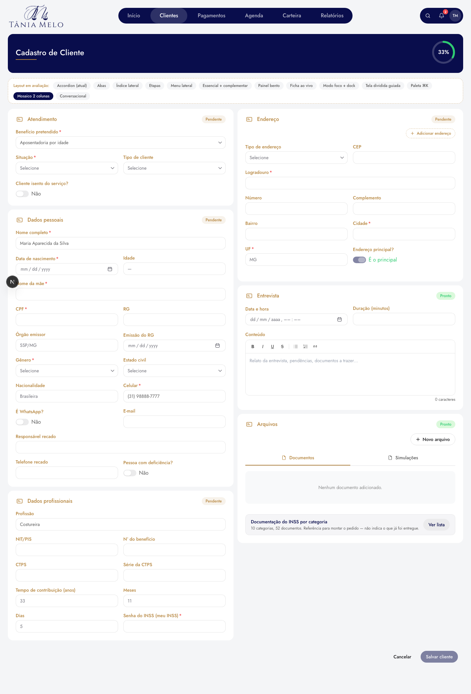

| Prós | Contras |
|---|---|
| Quase o formulário inteiro numa tela larga | A ordem de leitura desce a coluna da esquerda antes da direita |
| Nada para clicar para ver | Campos mais estreitos que no original |
| Zero navegação para aprender | Sem guia de "onde estou" |

### L — Conversacional (`ConversationLayout`) — ❌ descartada

Referências: formulários em conversa (UX Movement, "multi-step forms need to
be conversational") e a recomendação da Baymard de transformar etapas
concluídas em **resumos editáveis**. Cada seção chega numa mensagem que
explica o que ela pede; respondida, vira um balão com o resumo ("Maria
Aparecida da Silva · (31) 98888-7777", "Falta: CPF…") e um "Editar".
Opcionais têm "Pular"; a última fecha com "Tudo respondido".

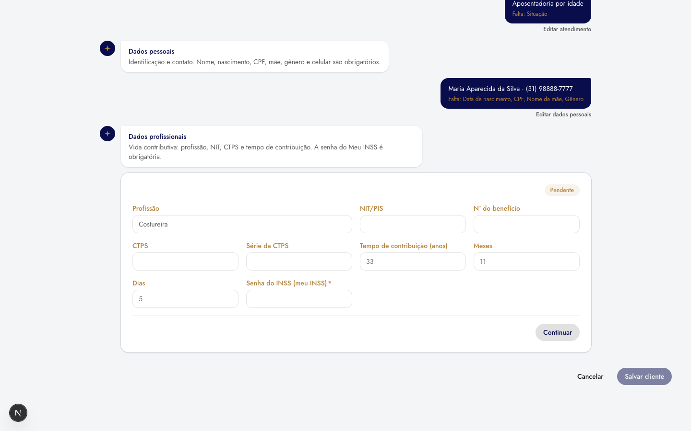

| Prós | Contras |
|---|---|
| Acolhedor, bom para atendimento ao vivo com o cliente | Mais lento para quem já sabe o que preencher |
| O que foi respondido fica visível em resumo | Sugere uma ordem |
| Muito natural no celular | Estilo foge do restante do sistema |

### Referência — o accordion de antes

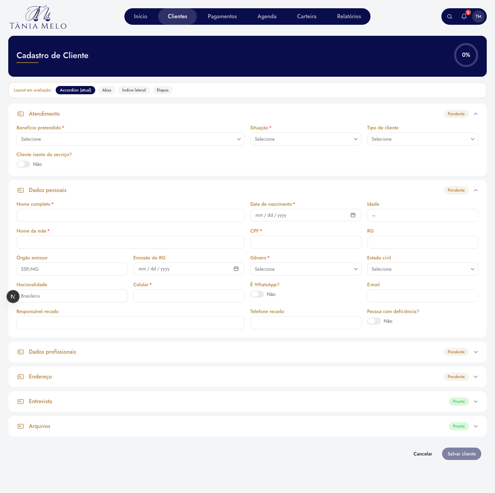

Celular: [abas](assets/layout-cadastro-cliente/mob-abas.png) ·
[índice](assets/layout-cadastro-cliente/mob-indice-scroll.png) ·
[etapas](assets/layout-cadastro-cliente/mob-etapas-2.png) ·
[menu](assets/layout-cadastro-cliente/mob-menu-proxima.png) ·
[essencial](assets/layout-cadastro-cliente/mob-essencial.png) ·
[bento](assets/layout-cadastro-cliente/mob-bento.png) ·
[ficha](assets/layout-cadastro-cliente/mob-ficha.png) ·
[foco](assets/layout-cadastro-cliente/mob-foco.png) ·
[guiado](assets/layout-cadastro-cliente/mob-guiado.png) ·
[paleta](assets/layout-cadastro-cliente/mob-paleta-aberta.png) ·
[mosaico](assets/layout-cadastro-cliente/mob-mosaico.png) ·
[conversa](assets/layout-cadastro-cliente/mob-conversa.png)

## 4. Como está implementado

```
src/components/clients/form/
  tabs/ClientFormTabs.tsx    as abas + a aba "Revisão" no fim
  tabs/ReviewPanel.tsx       o conteúdo da Revisão (só desenha)
  tabs/SectionCard.tsx       o cartão de cada aba
  tabs/SectionStatusDot.tsx  ponto de estado na aba
  tabs/useActiveSection.ts   aba ativa que segue o pedido de foco da página
  tabs/revealTop.ts          volta ao topo ao trocar de aba pelo rodapé
  tabs/types.ts              ClientFormSection, SectionFocus
  review.ts (+ .test.ts)     todos os campos, rótulo e valor, e o que falta
  genderPrompt.ts (+ .test.ts) quando perguntar o sexo; as opções
  GenderPromptModal.tsx      a pergunta
```

A página (`app/(private)/clientes/novo/page.tsx`) monta a lista de seções
**uma vez**. O antigo `setExpandedKeys` virou `focusSection(...)`: erro de
validação, "Revisar" e "Editar" (na Revisão) pedem uma aba, e as abas trocam
para ela e trazem o topo para a tela. Nenhuma regra de gravação mudou.

Mudança de comportamento: se o salvar falhar por campo obrigatório, a tela
vai até a primeira aba obrigatória com erro (antes, com o accordion, só
avisava).

O **modal de edição** de cliente (`DetailsClientModal`) continua em
accordion — por isso `FormSection` e o CSS `.client-form-accordion` ficaram.

## 5. Critérios sugeridos para decidir

1. Quem cadastra preenche **na ordem** ou **pula** entre seções?
2. O cadastro costuma ser feito **de uma vez** ou **aos poucos**?
3. Há muito uso no **celular**?
4. Revisar tudo antes de salvar é importante?

Entre as finalistas: pulando muito entre seções → **abas**. Nomes longos,
estado de todas sempre à vista → **menu lateral**. Pessoas novas ou que
precisam entender o porquê de cada bloco → **tela dividida guiada**.

## 5.1 Referências da pesquisa (opções I–L)

- [Eleken — 42 UX-friendly form design examples](https://www.eleken.co/blog-posts/form-design-examples)
  (duas colunas numa tela, etapas com progresso, painel lateral)
- [Baymard — Always collapse completed accordion checkout steps into summaries](https://baymard.com/blog/accordion-checkout-usability)
- [UX Movement — Why multi-step forms need to be conversational](https://uxmovement.substack.com/p/why-multi-step-forms-need-to-be-conversational)
- [Dribbble — onboarding form](https://dribbble.com/search/onboarding-form) e
  [Responsive onboarding form (inspirado na Stripe)](https://dribbble.com/shots/18078720-Responsive-onboarding-form)
- [Setproduct — Command palette UI design](https://www.setproduct.com/blog/command-palette-ui-design-guide)
- [IxDF — How to design UI forms in 2026](https://ixdf.org/literature/article/ui-form-design)

## 6. Decisão

| Data | Escolha | Motivo |
|---|---|---|
| 01/10/2026 | Corte: ficam A (abas), D (menu lateral), I (tela guiada) | Escolha do usuário entre as 12 |
| 01/10/2026 | **A — Abas**, com Revisão e pergunta de sexo | Escolha do usuário entre as finalistas |

## 7. Checklist da decisão

- [x] Remover as 9 descartadas e os resumos que só elas usavam.
- [x] Página usa as abas direto; saíram o seletor (`ClientFormLayout`,
      `FormLayoutSwitcher`, `useFormLayoutChoice`), o accordion do cadastro,
      o menu lateral e a tela guiada.
- [x] `FormSection` e `.client-form-accordion` **mantidos**: o modal de
      edição ainda usa.
- [x] e2e: `abrirSecao` de `clientes-crud` e `cadastro-endereco-em-lote`
      clica na aba; `deficiencia-crud` responde a pergunta de sexo.
- [x] Testes: `review.test.ts`, `genderPrompt.test.ts`,
      `e2e/cadastro-revisao.spec.ts` e dois casos novos em
      `deficiencia-crud.spec.ts`.
- [x] Atualizar este documento com a decisão.
- [ ] Opcional: levar as abas (e o acabamento da seção 9) ao modal de
      edição, para as duas telas ficarem iguais.

## 8. Acréscimos pedidos com a escolha

### Revisão

Aba **"Revisão"** no fim da barra e botão **"Revisar"** no rodapé, ao lado
de "Salvar cliente". Mostra **todos** os campos, seção por seção, com o
mesmo rótulo do formulário: valor preenchido, "—" para opcional vazio e
**"Não preenchido"** para obrigatório vazio, com a contagem no topo e em
cada seção. "Editar" leva à aba da seção. Detalhes:

- Chaves de enum viram o rótulo da tela; datas em `DD/MM/AAAA`; chaves
  liga/desliga em Sim/Não; tempo de contribuição numa frase.
- A **senha do INSS nunca aparece** — só "(preenchida)".
- Endereço, entrevista e deficiência só cobram obrigatórios quando a pessoa
  começou a preenchê-los, como no salvamento.

### Pergunta de sexo

Ao **trocar** o benefício pretendido para *Aposentadoria por deficiência*,
abre um modal "Qual o sexo do cliente?" com Feminino e Masculino (as duas
colunas da LC 142/2013). Um clique responde e já marca o campo **Gênero** em
Dados pessoais. Se o campo já tem uma das duas, ela vem marcada como
"atual". "Agora não" fecha sem mudar nada; Não-binário e Outro continuam
escolhidos no próprio campo. Escolher de novo o mesmo benefício, ou outro
benefício, não abre o modal.

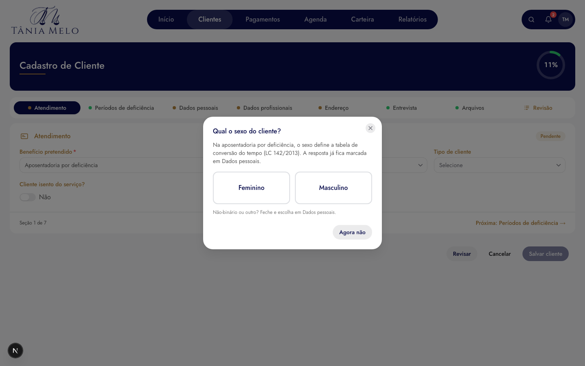

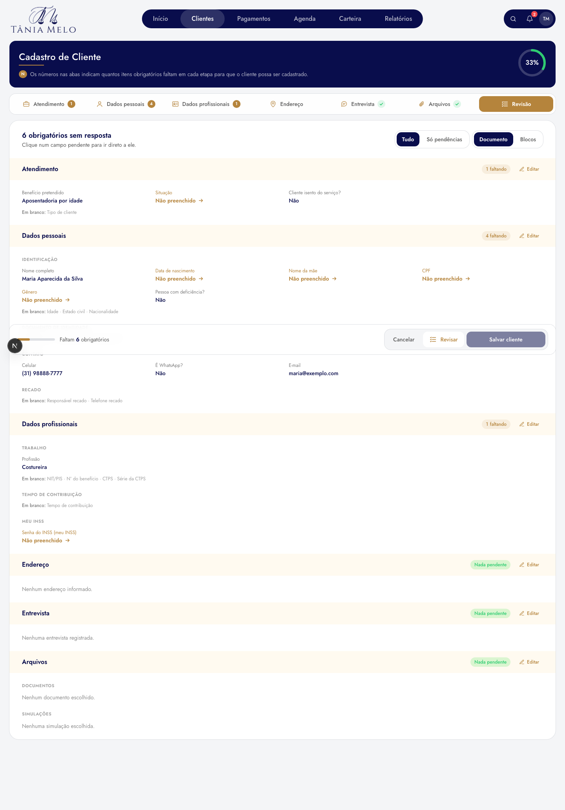

## 9. Acabamento moderno das abas

Pedido junto com a escolha: "um form moderno, apesar da escolha por abas".
O que mudou sobre as abas simples:

- **Barra de abas fixa e translúcida**: acompanha a rolagem (`sticky`, fundo
  com desfoque) — trocar de seção não exige voltar ao topo.
- **Ícone por seção** e, à direita do nome, **quantos obrigatórios faltam**
  (número dourado) ou um **✓** quando a seção está completa. Seção opcional
  intocada não mostra nada — o ponto dourado de antes acusava "pendente" em
  endereço vazio, que não é pendência.
- **Cabeçalho da seção** com o ícone num quadro tingido, título forte e uma
  frase do que a seção pede; selo de estado ao lado do título.
- **Campos em grupos com subtítulo**: Dados pessoais → Identificação,
  Documento de identidade, Contato, Recado; Dados profissionais → Trabalho,
  Tempo de contribuição, Meu INSS (`FormGroup`, em `FormSection.tsx`). A
  Revisão usa os mesmos grupos.
- **Rodapé da seção** com "← Anterior", "2 de 6" e "Próxima: …".
- **Entrada suave** do painel ao trocar de aba (respeita "reduzir
  movimento").
- **Barra de ações flutuante** (`FormActionBar`): barra de progresso,
  "Faltam N obrigatórios" ou "Pronto para salvar", e Cancelar · Revisar ·
  Salvar cliente sempre à mão. `sticky`, então pousa no fim do formulário
  sem cobrir nada.

- **Sem sombras**: o usuário não gostou delas; cartões e barras são planos,
  separados só por filete fino (`ring-1 ring-light-gray`). O indicador da aba
  leva `shadow-none` para anular a sombra padrão do HeroUI.
- **Botões no modelo do painel da Carteira**: `ActionGroup` /
  `ActionButton` / `ChipButton` (`components/ui/actions/ActionGroup.tsx`) —
  contêiner arredondado com os botões como segmentos; ação principal em azul
  e larga, secundária em dourado com ícone, chips com contorno ("Editar" da
  Revisão, "Excluir endereço").
- **Abas no mesmo modelo dos botões**: segmentos `rounded-xl` num contêiner
  com filete, a ativa em azul como a ação principal, as outras em cinza. O
  fundo da barra é **branco** (preferido ao cinza-claro do `ActionGroup`), e
  por isso o hover das abas vai para o cinza-claro.
- **Legenda dos números** no cabeçalho azul, sob o título: "Os números nas
  abas indicam quantos itens obrigatórios faltam em cada etapa para que o
  cliente possa ser cadastrado." Some quando não falta nada.

- **Revisão modernizada**: resumo no topo só com texto (quanto falta), o
  filtro "Tudo / Só pendências" e a chave de visualização — sem contador
  grande, sem ícones e sem atalhos por seção (removidos a pedido).
  Obrigatório vazio é "Não preenchido →" em dourado e leva direto à aba; o
  selo da seção diz "N faltando" ou "Nada pendente" (não "Completo":
  endereço em branco não tem pendência, mas não está completo).
- **Duas visualizações da Revisão, em comparação** (chave "Documento /
  Blocos", abre em Documento):
  - *Documento*: um cartão só, com o resumo no topo. Cada seção abre com
    uma **faixa creme** (`bg-floral`, a mesma do cabeçalho dos cartões das
    abas) — é ela que divide, sem linha nenhuma. Campos em 4 colunas, e os
    **opcionais em branco viram uma linha só** por grupo ("Em branco: RG ·
    Órgão emissor · Emissão do RG", `splitBlankOptional`). Histórico: a 1ª
    versão tinha filete sob cada campo ("um monte de linhas"); a 2ª, só
    espaço e divisor entre seções, ficou "extensa e muito branca";
  - *Blocos*: um cartão por seção, cada campo num bloco, como os do painel
    da Carteira.
  Escolhida uma, a outra e a chave saem.

- **Cabeçalho do cartão em creme**: fundo `floralwhite` (#FFFAF0, token
  `--color-floral` em `globals.css`, classe `bg-floral`) — escolhido pelo
  usuário testando no navegador; o rodapé do cartão ficou branco como o
  corpo.


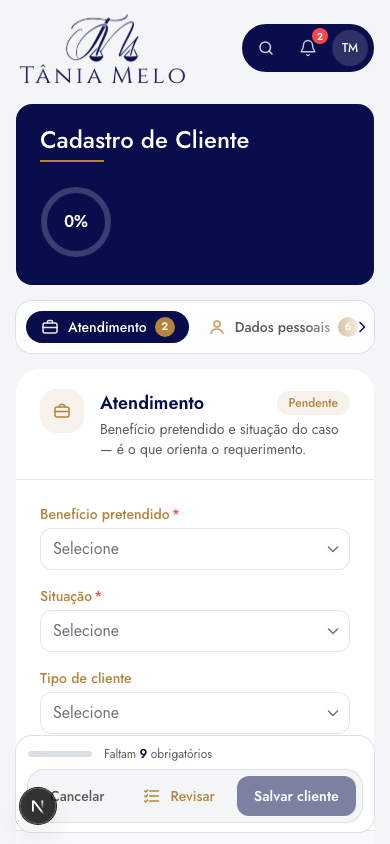

## 10. Estilos de formulário — em avaliação (02/10/2026)

Pedido: "10 tipos de forms diferentes, mantenha o esquema de abas, quero
forms mais modernos". As abas, os cartões, a Revisão e os botões ficam como
estão; muda só o visual dos **campos**. Uma faixa tracejada "Estilo do
formulário (em avaliação)" troca na hora; link direto `?estilo=<id>`.

Implementação: temas CSS em `components/clients/form/formStyles.css`,
ativados por `data-form-style` no contêiner das abas e ancorados em
`[data-form-grid]` (a `FormGrid`). Seletor e escolha em
`FormStyleSwitcher.tsx`. Nenhum estilo usa sombra. Escolhido um, ele vira o
padrão e o resto sai.

| id | Nome | Ideia |
|---|---|---|
| `atual` | Atual | referência |
| `preenchido` | Preenchido | caixa cinza-clara sem borda; sublinhado dourado no foco |
| `linha` | Sublinhado | só a linha de baixo; rótulo pequeno em caixa alta |
| `flutuante` | Rótulo dentro | rótulo no alto, dentro da caixa (estilo Stripe) |
| `pilula` | Pílula creme | caixas arredondadas no creme `floralwhite` |
| `cartao` | Cartão por campo | cada campo é um bloco; fica creme ao editar |
| `lateral` | Rótulo ao lado | rótulo à esquerda, campo à direita (tela de configurações); empilha no celular |
| `editorial` | Editorial | campos grandes, rótulos dourados espaçados |
| `lavanda` | Azul suave | caixas tingidas do azul da marca |
| `foco` | Foco | os campos que não estão sendo editados esmaecem |
| `acento` | Acento dourado | filete dourado à esquerda de cada campo |

Prints (aba Dados pessoais, "Nome completo" em foco) em
`assets/layout-cadastro-cliente/estilos/`.

### 10.1 Rodada 2 — mais ousados (02/10/2026)

A primeira rodada não pareceu moderna o bastante ("não seguindo um padrão").
Dez novos, cada um com uma ideia diferente — cor, estrutura, tipografia,
movimento, retorno de preenchimento. Ficam na primeira linha da faixa; a
rodada 1 continua na segunda linha, "Rodada anterior".

| id | Nome | Ideia |
|---|---|---|
| `noturno` | Painel noturno | cada grupo vira um painel azul-marinho; campos translúcidos, texto branco |
| `gradiente` | Borda gradiente | contorno em degradê dourado → azul, mais forte no foco |
| `entalhe` | Rótulo no contorno | rótulo cortando a borda (outlined do Material) |
| `typeform` | Tipográfico | sem caixas, texto digitado grande, duas colunas, muito espaço |
| `mosaico` | Mosaico em tons | cada campo num bloco de cor da marca (creme, lavanda, menta, areia) |
| `orbita` | Órbita | contorno dourado/azul girando em volta do campo em foco (respeita "reduzir movimento") |
| `numerado` | Numerado | número grande (01, 02…) por campo, contínuo na aba |
| `faixa` | Rótulo em faixa | rótulo numa aba creme grudada em cima da caixa |
| `confirmacao` | Confirmação viva | ✓ verde no campo preenchido; obrigatório vazio tracejado em dourado |
| `vidro` | Vidro | grupo sobre gradiente suave; campos translúcidos e desfocados |

## 11. Modos de preenchimento — experimentais (02/10/2026)

As duas rodadas de estilos de campo (seção 10) não surpreenderam: "o atual
continua fazendo mais sentido". Pedido: "5 tipos de form super inovadores,
fugindo à regra de todos até agora". Em vez de mudar a aparência do campo,
cada modo muda **a forma de entrar com os dados**. Todos editam os mesmos
formulários da página (trocar de modo não perde nada; "Salvar cliente"
grava o que qualquer modo preencheu); "Revisar" volta às abas. Escolha em
"Como você quer preencher?" ou `?modo=`.

| id | Modo | Ideia |
|---|---|---|
| `peticao` | Petição viva | o parágrafo de qualificação da parte com lacunas; concorda com o gênero e copia pronto para a peça |
| `colar` | Colar e preencher | cola a mensagem do WhatsApp; o extrator acha CPF, nascimento, mãe, celular, e-mail, endereço, NIT, benefício… e mostra de onde tirou cada um antes de aplicar |
| `voz` | Ditado por voz | fala os dados (Web Speech, pt-BR, Chrome/Edge); a transcrição é editável e passa pelo mesmo extrator |
| `carteirinha` | Carteirinha | edita direto no cartão do cliente com a marca do escritório; vira em 3D (frente: identificação; verso: previdência) |
| `linha` | Linha da vida | a trajetória (nascimento → identidade → trabalho → pedido) e uma régua que desenha idade e tempo de contribuição |

Código em `components/clients/form/modes/`. O extrator (`smartFill.ts`) e
o texto da qualificação (`qualification.ts`) são funções puras com testes.
Limite: deficiência, vários endereços, entrevista e arquivos só existem
nas abas. Prints em `assets/layout-cadastro-cliente/modos/`.

### 11.1 Ditado por voz — o preferido; microfone endurecido

O usuário gostou do ditado e pediu garantia de que o microfone funcione.
O que mudou (`modes/dictation.ts`, testado com reconhecedor falso):

- **Não para nas pausas.** O Chrome encerra o reconhecimento após alguns
  segundos de silêncio; a sessão religa sozinha até a pessoa apertar parar.
- **Pede o microfone antes** (`getUserMedia`): mostra o pedido de permissão
  e separa os casos com mensagem própria — bloqueado, sem microfone, em uso
  por outro programa (Teams/Zoom), sem internet, endereço sem https,
  navegador sem ditado. Erro desconhecido mostra o código do navegador.
- **Medidor de volume ao vivo** enquanto ouve — prova que o som chega.
- **Vigia de transcrição:** se há som mas o navegador não devolve texto em
  ~8 s, avisa (serviço de transcrição fora / sem internet) em vez de ficar
  em "Ouvindo…" para sempre.
- **Clique duplo** não quebra.
- **Fala → texto que o extrator entende** (`normalizeDictation`): rótulo
  falado vira linha nova ("mãe … celular …"), "nome X" vira "Nome: X",
  "20 de maio de 1965" → 20/05/1965, "31 98888 7777" → um número só,
  "maria ponto silva arroba gmail ponto com" → e-mail, "número 123" → nº.

Verificado no navegador (Chromium + Playwright): microfone falso tocando
fala real gerada pelo `say` (pt-BR) → medidor reage; reconhecedor
simulado com pausa → religa, transcreve, extrai 5 dados e aplica nas abas;
bloqueado / em uso / sem microfone → mensagem certa. **Não verificado aqui:**
a transcrição do serviço real (Chrome/Edge não instalados nesta máquina; o
Chromium de teste não tem o serviço). Requisitos em produção: Chrome ou
Edge, internet e **https**.

