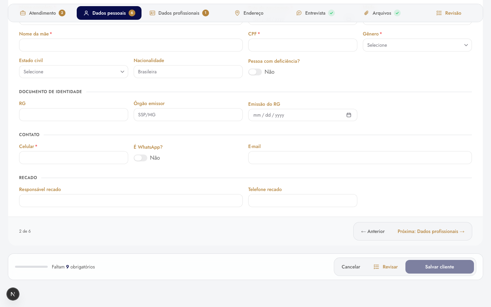
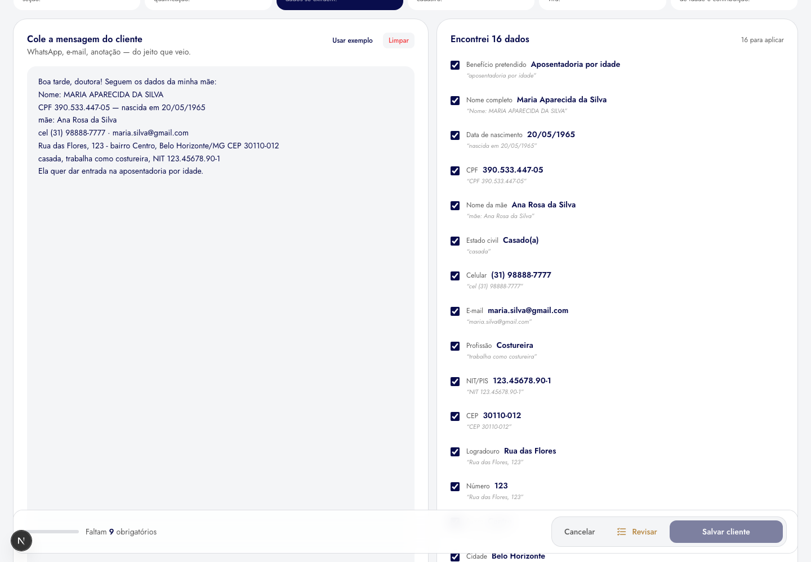

# ADR 0002 — Layout do cadastro de cliente: abas, Revisão e modos de preenchimento

- **Status:** aceita e implementada.
- **Data:** decidida em 01/10/2026; modos de preenchimento reduzidos em
  08/10/2026.
- **Onde vive:** `components/clients/form/` — `ClientFormPage.tsx`,
  `tabs/` (`ClientFormTabs`, `ReviewPanel`, `FormActionBar`, `SectionCard`),
  `review.ts`, `genderPrompt.ts` + `GenderPromptModal.tsx`, `modes/`.

## Contexto

O cadastro (`/clientes/novo`) tem seis seções (sete com "Períodos de
deficiência") e cerca de 40 campos. Em accordion, achar um campo era abrir e
fechar cartão, várias seções abertas se empilhavam e não havia visão de onde se
estava no formulário.

Doze alternativas foram montadas e comparadas **na própria tela**, com uma
faixa que trocava o layout sem perder o que já fora digitado: abas, índice
lateral, etapas, menu lateral, essencial + complementar, painel bento, ficha ao
vivo, modo foco, tela dividida guiada, paleta ⌘K, mosaico e conversacional.
No primeiro corte ficaram abas, menu lateral e tela guiada.

## Decisão

**Abas**, uma seção por vez, com:

- **Barra de abas fixa** (acompanha a rolagem), ícone por seção e, ao lado do
  nome, quantos obrigatórios faltam — ou ✓ quando a seção está completa. Seção
  opcional intocada não acusa nada.
- **Não se sai de uma aba com obrigatório pendente**: o "Próxima" e o clique
  na aba validam a atual e mostram os erros ali.
- **Barra de ações flutuante** (`FormActionBar`): progresso, "Faltam N
  obrigatórios" ou "Pronto para salvar", e Cancelar · Revisar · Salvar
  cliente sempre à mão.
- **Aba "Revisão"** no fim: todos os campos, seção por seção, com o rótulo do
  formulário — valor, "—" para opcional vazio, "Não preenchido →" para
  obrigatório vazio (leva à aba). A senha do INSS nunca aparece, só
  "(preenchida)". Endereço, entrevista e deficiência só cobram obrigatório
  quando a pessoa começou a preenchê-los, como no salvamento.
- **Pergunta de sexo**: trocar o benefício para *Aposentadoria por
  deficiência* pergunta "Qual o sexo do cliente?" (as duas colunas da LC
  142/2013) e já marca o Gênero em Dados pessoais. "Agora não" não muda nada.

### Modos de preenchimento

Além das abas, dois modos que mudam **a forma de entrar com os dados**, não a
aparência. Os dois escrevem nos mesmos formulários da página — trocar de modo
não perde nada, e "Salvar cliente" grava o que qualquer um preencheu:

- **Colar e preencher** (`PasteMode`): cola a mensagem do WhatsApp; o extrator
  (`smartFill.ts`, função pura com testes) acha CPF, nascimento, mãe, celular,
  e-mail, endereço, NIT, benefício e mostra de onde tirou cada um antes de
  aplicar.
- **Ditado por voz** (`VoiceMode`, `dictation.ts`): Web Speech em pt-BR. Religa
  sozinho nas pausas, pede o microfone antes e explica cada falha (bloqueado,
  sem microfone, em uso por outro programa, sem https), mostra o volume ao
  vivo e normaliza a fala para o extrator ("20 de maio de 1965" → 20/05/1965).
  Exige Chrome ou Edge, internet e **https**.

Deficiência, vários endereços, entrevista e arquivos só existem nas abas.

## Alternativas descartadas

- **Menu lateral** e **tela dividida guiada** (finalistas): bons para nomes
  longos e para quem precisa do porquê de cada bloco, mas mais pesados para
  quem pula entre seções — o uso real do escritório.
- **Etapas** (wizard): força a ordem; quem cadastra pula de seção.
- As outras sete: ou escondiam a estrutura (paleta, conversacional), ou
  repetiam a ficha (ficha ao vivo, bento), ou não cabiam no celular.
- **Estilos de campo** (duas rodadas, vinte estilos): nenhum superou o atual.
- **Petição viva, Carteirinha e Linha da vida** (modos de preenchimento,
  removidos em 08/10/2026): vistosos, mas sem uso no dia a dia.

O código e as capturas das alternativas estão no histórico do git
(`docs/PROPOSTA_LAYOUT_CADASTRO_CLIENTE.md` e `docs/assets/layout-cadastro-cliente/`,
até o commit `e9ec3f5`).

## Consequências

- Campo com erro pode estar em outra aba: o "Salvar" leva até a primeira aba
  obrigatória com erro.
- Sete abas não cabem no celular: a barra rola na horizontal.

  

- A **ficha** (`ClientDetailsModal`) não usa abas: lá a leitura vem antes da
  edição, e as seções ficam todas na tela, ancoradas por um painel lateral
  (`SheetLayout`). As duas telas compartilham schemas e seções
  ([ADR 0001](0001-schema-driven-forms.md)), não o layout.
- **Em aberto:** a Revisão ainda tem as duas visualizações em comparação —
  *Blocos* (abre nela) e *Documento* —, com a chave na tela. Escolhida uma, a
  outra e a chave saem.
